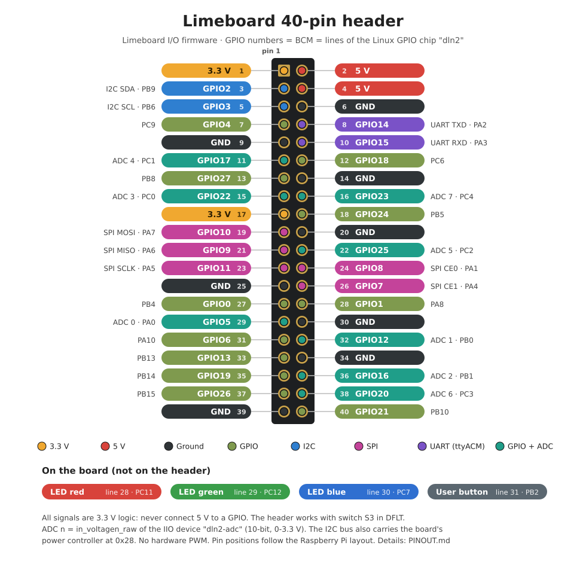

# Limeboard pinout

This page covers the Limeboard's 40-pin header, the microcontroller signals
behind it, the other signals of the STM32, and the board's jumpers and
switches. It applies to the **Limeboard I/O firmware**.

Sources:
- the Limeboard I/O firmware (`src/board.c`, `src/adc.c`, `src/spi.c`);
- the board definition of the original CircuitPython firmware;
- the Citronics wiki pages [MCU hardware](https://wiki.citronics.eu/MCU_hardware),
  [Board configurations](https://wiki.citronics.eu/Board_configurations) and
  [Power modes](https://wiki.citronics.eu/Power_modes).

## 40-pin header

`tools/pinout_svg.py` generates this diagram. Keep its pin table in step
with the tables below.

The header follows the Raspberry Pi layout and BCM numbering. In Linux,
"Line" is the line number on the GPIO chip `dln2`, which is the same as the
BCM number. "Function" lists what the Limeboard I/O firmware provides on
the pin besides plain GPIO. "ADC" gives the IIO channel
(`in_voltageN_raw` of the `dln2-adc` device).

| Function | ADC | STM32 | Line | Pin | Pin | Line | STM32 | ADC | Function |
|---:|:-:|:-:|:-:|:-:|:-:|:-:|:-:|:-:|:---|
| **3.3 V** | | | | 1 | 2 | | | | **5 V** |
| I2C1 SDA | | PB9 | 2 | 3 | 4 | | | | **5 V** |
| I2C1 SCL | | PB6 | 3 | 5 | 6 | | | | **GND** |
| | | PC9 | 4 | 7 | 8 | 14 | PA2 | | UART TXD |
| **GND** | | | | 9 | 10 | 15 | PA3 | | UART RXD |
| SPI1 CE1 | 4 | PC1 | 17 | 11 | 12 | 18 | PC6 | | SPI1 CE0 |
| | | PB8 | 27 | 13 | 14 | | | | **GND** |
| | 3 | PC0 | 22 | 15 | 16 | 23 | PC4 | 7 | |
| **3.3 V** | | | | 17 | 18 | 24 | PB5 | | |
| SPI0 MOSI | | PA7 | 10 | 19 | 20 | | | | **GND** |
| SPI0 MISO | | PA6 | 9 | 21 | 22 | 25 | PC2 | 5 | |
| SPI0 SCLK | | PA5 | 11 | 23 | 24 | 8 | PA1 | | SPI0 CE0 |
| **GND** | | | | 25 | 26 | 7 | PA4 | | SPI0 CE1 |
| I2C0 SDA | | PB4 | 0 | 27 | 28 | 1 | PA8 | | I2C0 SCL |
| | 0 | PA0 | 5 | 29 | 30 | | | | **GND** |
| | | PA10 | 6 | 31 | 32 | 12 | PB0 | 1 | |
| | | PB13 | 13 | 33 | 34 | | | | **GND** |
| SPI1 MISO | | PB14 | 19 | 35 | 36 | 16 | PB1 | 2 | SPI1 CE2 |
| | | PB15 | 26 | 37 | 38 | 20 | PC3 | 6 | SPI1 MOSI |
| **GND** | | | | 39 | 40 | 21 | PB10 | | SPI1 SCLK |

The same data sorted by GPIO:

| GPIO (line) | Header pin | STM32 | Function (Limeboard I/O firmware) | Raspberry Pi function |
|:-:|:-:|:-:|---|---|
| 0 | 27 | PB4 | GPIO, I2C0 SDA (second I2C bus) | I2C0 SDA (HAT EEPROM) |
| 1 | 28 | PA8 | GPIO, I2C0 SCL (second I2C bus) | I2C0 SCL (HAT EEPROM) |
| 2 | 3 | PB9 | I2C1 SDA | I2C1 SDA |
| 3 | 5 | PB6 | I2C1 SCL | I2C1 SCL |
| 4 | 7 | PC9 | GPIO | GPCLK0 |
| 5 | 29 | PA0 | GPIO, ADC 0 | |
| 6 | 31 | PA10 | GPIO | |
| 7 | 26 | PA4 | SPI0 CE1 | SPI0 CE1 |
| 8 | 24 | PA1 | SPI0 CE0 | SPI0 CE0 |
| 9 | 21 | PA6 | SPI0 MISO | SPI0 MISO |
| 10 | 19 | PA7 | SPI0 MOSI | SPI0 MOSI |
| 11 | 23 | PA5 | SPI0 SCLK | SPI0 SCLK |
| 12 | 32 | PB0 | GPIO, ADC 1 | PWM0 |
| 13 | 33 | PB13 | GPIO | PWM1 |
| 14 | 8 | PA2 | UART TXD (`/dev/ttyACM*`) | UART TXD |
| 15 | 10 | PA3 | UART RXD (`/dev/ttyACM*`) | UART RXD |
| 16 | 36 | PB1 | GPIO, ADC 2, SPI1 CE2 | SPI1 CE2 |
| 17 | 11 | PC1 | GPIO, ADC 4, SPI1 CE1 | SPI1 CE1 |
| 18 | 12 | PC6 | GPIO, SPI1 CE0 | SPI1 CE0, PCM CLK, PWM0 |
| 19 | 35 | PB14 | GPIO, SPI1 MISO | SPI1 MISO, PCM FS |
| 20 | 38 | PC3 | GPIO, ADC 6, SPI1 MOSI | SPI1 MOSI, PCM DIN |
| 21 | 40 | PB10 | GPIO, SPI1 SCLK | SPI1 SCLK, PCM DOUT |
| 22 | 15 | PC0 | GPIO, ADC 3 | |
| 23 | 16 | PC4 | GPIO, ADC 7 | |
| 24 | 18 | PB5 | GPIO | |
| 25 | 22 | PC2 | GPIO, ADC 5 | |
| 26 | 37 | PB15 | GPIO | |
| 27 | 13 | PB8 | GPIO | |

### Electrical notes

- All signal pins are 3.3 V logic: the STM32F401 runs from the board's
  +3.3 V MCU rail. Most STM32 pins tolerate 5 V as digital inputs, but the
  ADC pins do not, and 3.3 V is the safe rule for all of them.
- Keep the current of a pin to a few mA, for example an LED with a
  330 Ω to 1 kΩ resistor. The STM32 limits each pin to 25 mA and the
  whole chip to 120 mA.
- A pin that no function uses is an input without pull-up or pull-down.
  The I2C pins have the STM32's internal pull-ups enabled while I2C is in
  use. Long wires or many devices need external 4.7 kΩ pull-ups to 3.3 V,
  which most breakout boards already have.
- ADC inputs: 0 to 3.3 V, 10-bit (0-1023). The IIO `scale` attribute
  converts raw values to millivolts.
- The 3.3 V and 5 V pins come from the board's power rails. The +5V breaker
  jumper P10 feeds the 5 V rail and the +3.3 V MCU rail (see below). Check
  a power pin with a multimeter before you rely on it.
- Pin functions follow the Raspberry Pi layout. Pins 3 and 5 (I2C) are
  confirmed with a real device. Check other physical pin positions with a
  multimeter or an LED on your board revision before you build something
  permanent.

### Not available on the header

Compared with a Raspberry Pi, the Limeboard I/O firmware does not provide:
hardware PWM, PCM/I2S audio, GPCLK, and more than one UART (see
[One UART](README.md#one-uart)). The HAT ID EEPROM is not read at boot: GPIO0/1
are a plain second I2C bus here.

The buses, as on a Pi with i2c0, spi0 and spi1 enabled:
- I2C1 on GPIO2/3 and I2C0 on GPIO0/1;
- SPI0 (`/dev/spidev0.0`, `0.1`) on GPIO9-11, chip selects GPIO8/7;
- SPI1 (`/dev/spidev1.0`, `1.1`, `1.2`) on GPIO19-21, chip selects GPIO18/17/16.

See the [SPI example](examples/spi/README.md). The second buses need a kernel
whose `dln2` driver adds a bus for each port.

## Onboard signals of the STM32

These are not on the header. The board has one RGB LED, and each of its three
colour channels is driven by its own STM32 pin. Lines 28-31 of the `dln2` chip
expose the three channels and the button. The firmware keeps the other signals
away from Linux on purpose.

| Signal | STM32 | Linux | Function |
|---|:-:|---|---|
| LED_R | PC11 | `dln2` line 28 | red channel of the RGB LED (1 = on) |
| LED_G | PC12 | `dln2` line 29 | green channel of the RGB LED (1 = on) |
| LED_B | PC7 | `dln2` line 30 | blue channel of the RGB LED (1 = on) |
| BTN | PB2 | `dln2` line 31 | user button (input). Held at power-up: STM32 ROM bootloader (DFU) |
| FP_PWRKEY | PA15 | not exposed | phone's power key |
| FP_BUT_UP | PC13 | not exposed | phone's volume-up key |
| FP_BUT_DWN | PC10 | not exposed | phone's volume-down key |
| FP_CAM_BUT | PC8 | not exposed | phone's camera key |
| HUB_nRST | PB3 | not exposed | resets the USB hub, which also cuts the STM32's own USB link |

Pins with fixed roles (from the Citronics wiki):

| STM32 | Role |
|:-:|---|
| PA11, PA12 | USB D-, D+ (link to the phone through the hub) |
| PA13, PA14 | SWD debug (SWDIO, SWCLK) |
| PA9, PB7 | debug UART |
| PC14, PC15 | 32.768 kHz crystal (RTC) |
| PB12, PC5 | not connected |

The STM32 also connects to a 8 MHz crystal.

### The board's I2C bus

The header's I2C bus (`dln2-i2c`, GPIO2/3) also reaches the board's USB-C
power-delivery controller, an STUSB4500 at address **0x28**. `i2cdetect`
shows it, and external devices must not use that address. Do not write to
it: it negotiates the board's power supply.

## Microcontroller

| | |
|---|---|
| MCU | STM32F401RE (LQFP64), 84 MHz Cortex-M4 |
| Flash / RAM | 512 KiB / 96 KiB |
| Clocks | 8 MHz crystal (HSE), 32.768 kHz crystal (LSE, RTC) |
| Link to the phone | USB full speed, through the board's USB hub |
| USB ID (Limeboard I/O) | 1209:0001 |
| USB interfaces | 0: DLN-2 (GPIO, I2C, SPI, ADC), 1-2: CDC serial (header UART), 3: DFU runtime |

## Jumpers, switches and LEDs of the board

From the Citronics wiki
([Board configurations](https://wiki.citronics.eu/Board_configurations),
[Power modes](https://wiki.citronics.eu/Power_modes)):

| Ref | Kind | Marking | Function |
|---|---|---|---|
| S3 | switch, top left | `DFLT` / `DBG` | `DFLT` (left) enables the MCU, USB-A and Ethernet. `DBG` (right) disables them and connects USB-C directly to the phone. **The header works only in `DFLT`.** |
| J2 | 3-pin jumper, next to the USB-A ports | `PWR SRC`: `POE` / `USB` | power source: PoE (Ethernet) or USB-C Power Delivery. Middle pin: **HV PWR** input, 5 V to 60 V unregulated |
| J3 | 3-pin jumper, next to USB-C | `PWR` / `DBG` | USB-C as a power input, or connected directly to the phone |
| P10 | jumper, upper left | +5V breaker | feeds the phone's 5 V rail and the +3.3 V MCU rail. Upper pin: **LV PWR** input, 3.7 V to 5 V unregulated |
| J17 | jumper, below the coin cell | MCU RTC | powers the STM32's real-time clock from the coin cell |
| LED1 | green LED, upper left | | on when powered in `DFLT` mode |
| LED2 | red LED, middle left | | in `DFLT`: on once the phone has booted. On in `DBG` |
| FP2 `DWN`, `TRIG` | pads | | shorted at power-up (in `DBG` mode): the phone starts in fastboot |

Power: USB-C PD needs a charger of at least 10 W. The board draws about
2 W idle, 3.5 W at boot and up to 20 W under heavy load.
