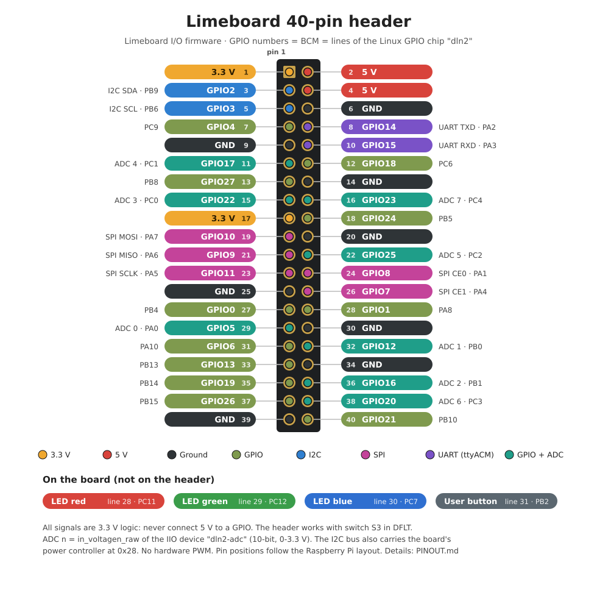

# Using the Limeboard header

The Limeboard is a Citronics carrier board for the Fairphone 2 and 3. Its
STM32 microcontroller runs the **Limeboard I/O firmware**, which turns the
board's 40-pin header into ordinary Linux devices, numbered like a
Raspberry Pi's. Programs talk to them with the same tools and libraries as
on a Pi: libgpiod, i2c-tools, smbus2, spidev, luma.oled.

This guide covers using the header with that firmware installed. For
building or flashing the firmware itself, see the `limeboard-firmware`
repository.

- [What the firmware provides](#what-the-firmware-provides)
- [Header pinout](#header-pinout) (complete version: [PINOUT.md](PINOUT.md))
- [Software to install](#software-to-install)
- [Finding the devices](#finding-the-devices)
- [Differences from a Raspberry Pi](#differences-from-a-raspberry-pi)
- Examples:
  1. [Onboard RGB LED](examples/onboard-led/README.md)
  2. [I2C OLED display](examples/i2c-oled/README.md)
  3. [LED on a header GPIO](examples/gpio-led/README.md)

## What the firmware provides

The STM32 connects to the phone over USB. The kernel's `dln2` drivers turn
it into these devices:

| Linux device | What it is |
|---|---|
| GPIO chip `dln2`, lines 0-27 | header GPIO0 to GPIO27 (BCM numbering) |
| GPIO chip `dln2`, lines 28, 29, 30 | onboard RGB LED: red, green, blue (1 = on) |
| GPIO chip `dln2`, line 31 | onboard user button (input) |
| I2C bus `dln2-i2c` (`/dev/i2c-N`) | SDA GPIO2, SCL GPIO3, 100 kHz |
| SPI controller (`spidev`) | MOSI GPIO10, MISO GPIO9, SCLK GPIO11, CE0 GPIO8, CE1 GPIO7 |
| IIO ADC `dln2-adc`, 8 channels, 10-bit, 0-3.3 V | GPIO5, 12, 16, 22, 17, 25, 20, 23 |
| USB serial port `/dev/ttyACM*` | UART TXD GPIO14, RXD GPIO15 |

The GPIO line number is the BCM GPIO number, so GPIO17 is line 17 of the
`dln2` chip. A pin is a plain GPIO until a function uses it. I2C, SPI and
the ADC claim their pins on first use, and the UART claims its pins while
its serial port is open.

Check that the firmware is running:

```sh
lsusb | grep 1209:0001         # the Limeboard I/O firmware
gpiodetect | grep dln2         # its GPIO chip
i2cdetect -l | grep dln2       # its I2C bus
```

## Header pinout

The header follows the Raspberry Pi layout. [PINOUT.md](PINOUT.md) has the
complete pinout: all 40 pins with their GPIO, STM32 pin and functions, the
onboard LED, button and other STM32 signals, and the board's jumpers and
switches.



| Function | Pin | Pin | Function |
|---:|:-:|:-:|:---|
| 3.3 V | 1 | 2 | 5 V |
| GPIO2 (I2C SDA) | 3 | 4 | 5 V |
| GPIO3 (I2C SCL) | 5 | 6 | GND |
| GPIO4 | 7 | 8 | GPIO14 (UART TXD) |
| GND | 9 | 10 | GPIO15 (UART RXD) |
| GPIO17 (ADC 4) | 11 | 12 | GPIO18 |
| GPIO27 | 13 | 14 | GND |
| GPIO22 (ADC 3) | 15 | 16 | GPIO23 (ADC 7) |
| 3.3 V | 17 | 18 | GPIO24 |
| GPIO10 (SPI MOSI) | 19 | 20 | GND |
| GPIO9 (SPI MISO) | 21 | 22 | GPIO25 (ADC 5) |
| GPIO11 (SPI SCLK) | 23 | 24 | GPIO8 (SPI CE0) |
| GND | 25 | 26 | GPIO7 (SPI CE1) |
| GPIO0 | 27 | 28 | GPIO1 |
| GPIO5 (ADC 0) | 29 | 30 | GND |
| GPIO6 | 31 | 32 | GPIO12 (ADC 1) |
| GPIO13 | 33 | 34 | GND |
| GPIO19 | 35 | 36 | GPIO16 (ADC 2) |
| GPIO26 | 37 | 38 | GPIO20 (ADC 6) |
| GND | 39 | 40 | GPIO21 |

The pins are 3.3 V logic. Never connect 5 V to a GPIO. The header works
only with the board's mode switch S3 in `DFLT`.

## Software to install

**Debian and Ubuntu images:**

```sh
sudo apt install gpiod python3-libgpiod i2c-tools python3-smbus2 python3-pil python3-venv
```

- `gpiod` provides the command line tools `gpiodetect`, `gpioinfo`,
  `gpioget`, `gpioset` and `gpiomon` (libgpiod v2).
- `python3-libgpiod` provides the `gpiod` Python module (libgpiod v2 API).
- `i2c-tools` provides `i2cdetect`, `i2cget` and `i2cset`.

For libraries that are not packaged, such as luma.oled, use a virtual
environment that also sees the system packages:

```sh
python3 -m venv --system-site-packages ~/limeboard-venv
~/limeboard-venv/bin/pip install luma.oled
```

**Buildroot images:** these include `i2c-tools` and the Python 3 standard
library. The examples also have a variant that needs only `/sys/class/gpio`.

The examples access `/dev/gpiochip*` and `/dev/i2c-*`. Run them as root
(with `sudo`), or give your user access to those device files.

## Finding the devices

The GPIO chip and I2C bus numbers depend on the order in which devices
appear, so look them up by name instead of hard-coding `gpiochip4` or
`i2c-1`.

Shell:

```sh
chip=$(gpiodetect | awk '/\[dln2\]/ { print $1 }')     # e.g. gpiochip4
bus=$(i2cdetect -l | awk '/dln2-i2c/ { sub("i2c-", "", $1); print $1 }')   # e.g. 1
```

Python:

```python
import glob, os, gpiod

def find_chip(label="dln2"):
    for path in sorted(glob.glob("/dev/gpiochip*")):
        with gpiod.Chip(path) as chip:
            if chip.get_info().label == label:
                return path

def find_i2c_bus(name="dln2-i2c"):
    for path in glob.glob("/sys/bus/i2c/devices/i2c-*"):
        with open(path + "/name") as f:
            if f.read().startswith(name):
                return int(os.path.basename(path)[4:])
```

## Differences from a Raspberry Pi

- **No hardware PWM.** A GPIO is either on or off. Every change travels
  over USB and takes about a millisecond, so software PWM flickers. Fading
  an LED or driving a servo needs an external PWM chip, such as a PCA9685
  on the I2C bus.
- **Pi-only libraries.** `RPi.GPIO`, `pigpio` and gpiozero's default pin
  factories access the Raspberry Pi's SoC directly or check for a Pi board,
  so they do not work here. Use libgpiod: the `gpiod` Python module and the
  `gpio*` tools work on any Linux board, including a Raspberry Pi 5.
- **I2C messages are limited to 256 bytes.** Most drivers send small
  messages and are not affected. A library that writes a whole frame buffer
  in one message must split it; see the [OLED example](examples/i2c-oled/README.md).
- **One I2C bus and one SPI bus.** The Pi's second SPI bus (GPIO16-21) is
  not available.
- **ADC.** The header has eight 10-bit analog inputs, which the Pi lacks.
  They appear in `/sys/bus/iio/devices/iio:deviceN/` (name `dln2-adc`).

## The Home Assistant agent and the onboard LED

On images that include `limeboard-ha`, the Home Assistant agent uses the
onboard LED and button (lines 28-31). A line in use by one program cannot be
requested by another, and the tools report `Device or resource busy`. To use
the LED from your own programs, stop the agent first:

```sh
sudo systemctl stop limeboard-ha            # Debian, Ubuntu
/etc/init.d/S95limeboard-ha stop            # Buildroot
```

The agent exports the lines through `/sys/class/gpio`, and the exports
remain after the agent stops. Release them so that libgpiod can request the
lines:

```sh
for f in /sys/class/gpio/gpiochip*; do
	[ "$(cat $f/label)" = dln2 ] && base=$(cat $f/base)
done
for line in 28 29 30 31; do
	[ -d /sys/class/gpio/gpio$((base + line)) ] && echo $((base + line)) > /sys/class/gpio/unexport
done
```
